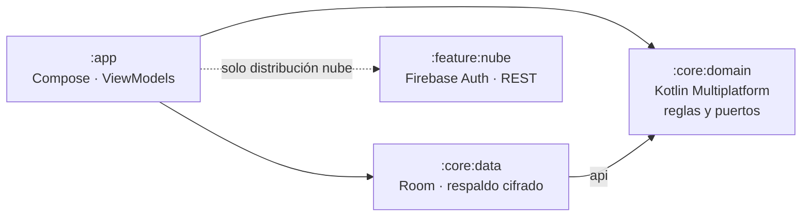

# Kren

**Finanzas personales para México que funcionan sin internet.**

[](https://github.com/Joako601/Finanzas/actions/workflows/ci.yml)
[](https://github.com/Joako601/Finanzas/releases)
-3DDC84?logo=android&logoColor=white)


Kren es una app Android para llevar el dinero del día a día en México. Está pensada para
la quincena, el ciclo de las tarjetas de crédito y las compras a meses sin intereses. Los
datos viven solo en el teléfono: la distribución principal **no tiene permiso de
internet**, y una regla del build impide que alguien se lo agregue por error.

> [!NOTE]
> Es un proyecto personal en desarrollo activo. La versión 1.0 la usa el autor a diario
> en su teléfono, pero todavía no se publica en Google Play
> ([hoja de ruta](docs/hoja-de-ruta.md)).

## Funciones

| Área | Qué hace |
|---|---|
| **Movimientos** | Gastos, ingresos y transferencias entre cuentas propias, en partida doble. Búsqueda y filtros por tipo, cuenta y categoría. |
| **Tarjetas de crédito** | Fechas de corte y de pago, captura del estado de cuenta (pago para no generar intereses y pago mínimo), saldo a favor y predicción del siguiente ciclo con su margen de error. |
| **Meses sin intereses** | Compras a 3, 6, 9, 12, 18 o 24 meses, con la mensualidad repartida en cada corte. |
| **Disponible real** | El saldo más bajo que tendrás en los próximos 30 días, después de pagos fijos, tarjetas y metas. Incluye una línea de tiempo día por día. |
| **Pagos y cobros fijos** | Quincenales, mensuales o cada *n* días. Se registran con un toque y avisan un día antes. |
| **Recordatorios** | Avisos antes del corte, para capturar el estado de cuenta y antes de la fecha límite de pago (con el monto). Las alarmas sobreviven a un reinicio del teléfono. |
| **Análisis** | Flujo del mes, gasto por categoría, curva de liquidez y patrimonio neto, comparados con el periodo anterior. |
| **Metas y topes** | Metas de ahorro con historial de aportes y topes de gasto por categoría, con aviso desde el 80 %. |
| **Respaldo** | Respaldo cifrado con tu contraseña (PBKDF2 + AES-GCM), restauración en una sola transacción y exportación a CSV. |
| **Privacidad** | Modo discreto que oculta los montos, bloqueo con el PIN del teléfono, pantallas protegidas contra capturas y opción de borrar todos los datos. |

## Principios de diseño

- **Sin red por defecto.** La distribución `privada` no declara `INTERNET`. Si algún
  cambio lo agrega, el build falla ([D-005](docs/decisiones.md#d-005-sin-permiso-internet-con-guardia-en-el-build)).
- **El dinero nunca es `Double`.** Se guarda como `Long` de centavos dentro de una
  `value class` ([D-003](docs/decisiones.md#d-003-dinero-como-long-de-centavos-en-una-value-class)).
- **Partida doble.** Cada movimiento son asientos que suman cero, así que los saldos
  siempre cuadran ([D-002](docs/decisiones.md#d-002-partida-doble)).
- **Actualizar nunca borra datos.** Cada cambio de esquema trae su migración de Room
  y su prueba, desde la versión 1 ([D-012](docs/decisiones.md#d-012-actualizar-sin-perder-datos-migraciones-obligatorias-desde-la-versión-1)).
- **Dominio puro.** `:core:domain` es Kotlin Multiplatform (JVM y JS), así que no puede
  importar nada de Android por accidente ([D-004](docs/decisiones.md#d-004-el-dominio-tiene-dos-objetivos-jvm-y-js-para-que-la-regla-de-pureza-sea-real)).
- **Dependencias verificadas.** Cada artefacto descargado se comprueba contra su SHA-256
  ([D-010](docs/decisiones.md#d-010-verificación-de-dependencias-con-sha-256)).

## Arquitectura



El dominio define los puertos (`RepositorioLibro`, `RepositorioTarjetas`, …) y
`:core:data` los implementa con Room. La app los conecta a mano, sin un framework de
inyección ([D-007](docs/decisiones.md#d-007-inyección-de-dependencias-manual-koin-pospuesto)).
En [docs/arquitectura.md](docs/arquitectura.md) están los diagramas de capas, de la base
de datos, del flujo de un gasto y de las distribuciones.

## Tecnologías

| Capa | Herramientas |
|---|---|
| Lenguaje | Kotlin 2.4 (JVM 17), Kotlin Multiplatform en el dominio |
| UI | Jetpack Compose (BoM 2026.09), Material 3, Lottie |
| Datos | Room 2.8 con migraciones automáticas y esquemas exportados, kotlinx-datetime |
| Concurrencia | Coroutines y Flow |
| Pruebas | Kotest (dominio, JVM y JS), JUnit 4, AndroidX Test, pruebas de Compose |
| Build | Gradle con catálogo de versiones, AGP 9.5, KSP, verificación SHA-256 |
| Nube (opcional) | Firebase Auth y Credential Manager, solo en la distribución `nube` |

Cada dependencia está justificada, con la alternativa que se descartó, en
[docs/decisiones.md](docs/decisiones.md#dependencias-y-su-razón).

## Cómo compilar

### Requisitos

- JDK 17 o superior (el proyecto se desarrolla con JDK 21)
- Android SDK con la plataforma 37 (Android Studio la descarga sola)
- Un teléfono con Android 8.0 (API 26) o superior

### Pasos

```bash
git clone https://github.com/Joako601/Finanzas.git
cd Finanzas
./gradlew :app:assemblePrivadaDebug
```

El APK queda en `app/build/outputs/apk/privada/debug/`. También puedes abrir la carpeta
en Android Studio y ejecutar la configuración `app`.

### Variantes

| Distribución | Paquete | Red | Para qué |
|---|---|---|---|
| `privada` | `io.github.joako601.finanzas` | No | La app principal |
| `nube` | `io.github.joako601.finanzas.nube` | Sí | Cuenta opcional con Firebase y catálogo |

Cada distribución tiene tres tipos de build: `debug` (sufijo `.debug`), `pruebas`
(`.pruebas`, para las pruebas instrumentadas sin tocar los datos de la app instalada) y
`release` (R8 con reducción de recursos).

La distribución `nube` compila sin credenciales. Para que funcione el inicio de sesión,
copia `firebase.properties.ejemplo` como `firebase.properties` y llena los valores. Ese
archivo está en `.gitignore`.

## Pruebas

```bash
./gradlew check                                  # dominio (JVM y JS), app y datos en la JVM, guardias
./gradlew :core:data:connectedDebugAndroidTest   # Room, migraciones y respaldo, en un dispositivo
./gradlew :app:connectedPrivadaPruebasAndroidTest # UI y accesibilidad, en un dispositivo
```

Cada versión se instala encima de la anterior en un teléfono real y se compara la
huella de la base antes y después. El registro de esas pruebas está en
[docs/verificacion.md](docs/verificacion.md).

## Estructura del repositorio

```text
app/                     UI en Compose, ViewModels y recordatorios
  src/privada|nube/      código propio de cada distribución
core/domain/             reglas de negocio puras (KMP)
core/data/               Room, DAOs, respaldo cifrado y esquemas exportados
feature/nube/            sesión, catálogo y red (solo distribución nube)
herramientas/            registrador de notificaciones y scripts de medición
gradle/                  catálogo de versiones, verificación y guardia de dependencias
docs/                    arquitectura, decisiones, hoja de ruta y verificación
scripts/                 instalación en un teléfono sin perder datos
```

## Documentación

- [Arquitectura](docs/arquitectura.md): módulos, capas, base de datos y flujos.
- [Decisiones](docs/decisiones.md): un registro tipo ADR, de D-001 a D-024.
- [Hoja de ruta](docs/hoja-de-ruta.md): qué está hecho y qué sigue.
- [Verificación](docs/verificacion.md): la evidencia de cada versión.
- [Cambios](CHANGELOG.md): el historial de versiones.

## Contribuir y seguridad

Los reportes de errores y las ideas son bienvenidos. Usa las plantillas de *issues* y
lee [CONTRIBUTING.md](CONTRIBUTING.md) antes de abrir un *pull request*. Si encuentras
una vulnerabilidad, no abras un *issue* público: sigue [SECURITY.md](SECURITY.md).
Este proyecto se rige por un [código de conducta](CODE_OF_CONDUCT.md).

## Licencia

Copyright © 2026 Joako601. Todos los derechos reservados.

El código está publicado para que se pueda leer y evaluar, pero no tiene licencia de
código abierto. No se permite copiarlo, modificarlo ni distribuirlo sin permiso escrito
del autor. Consulta [LICENSE](LICENSE).
