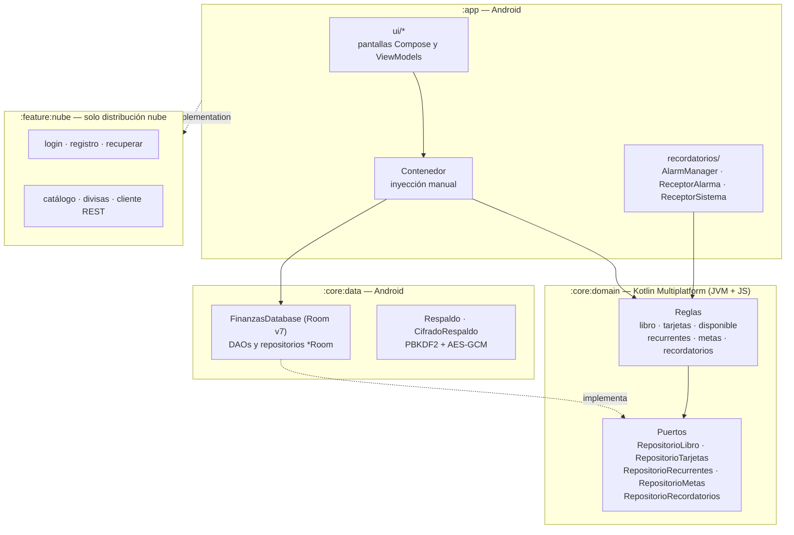
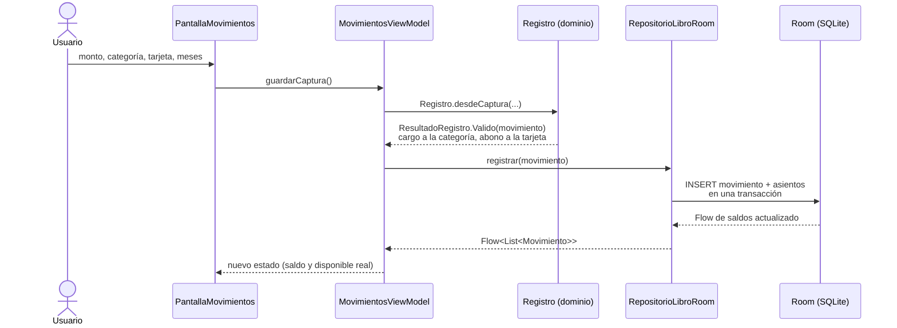
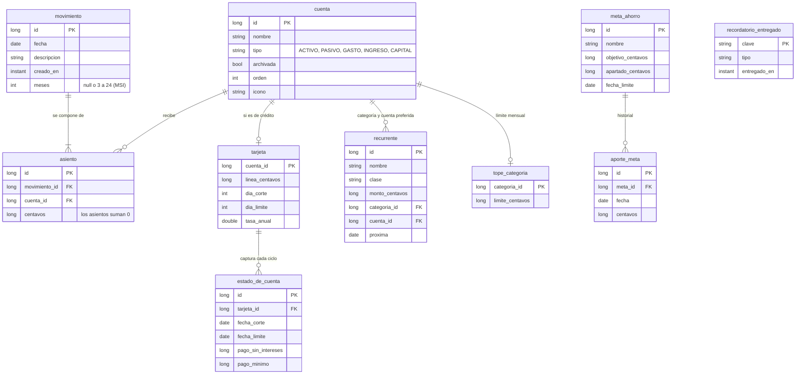
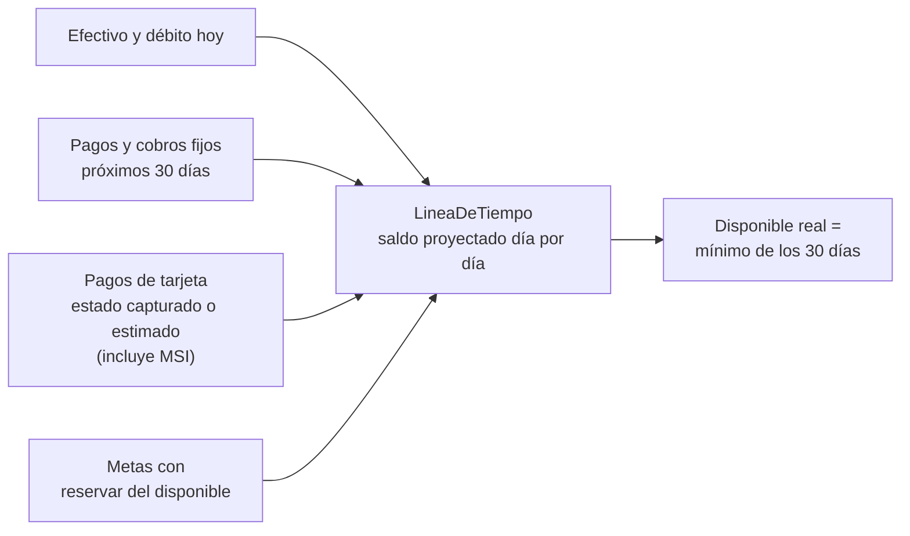
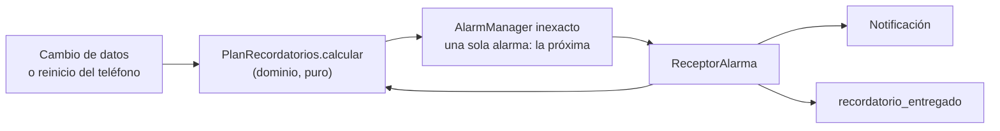
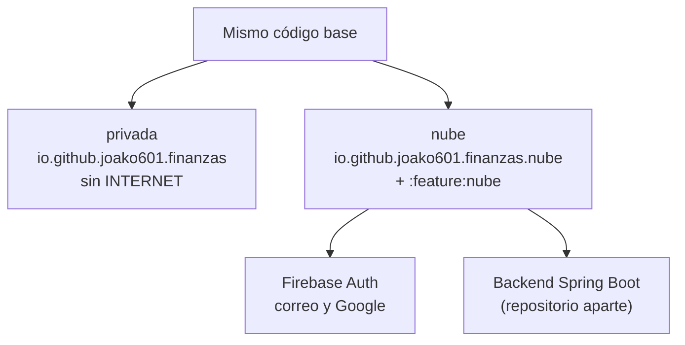

# Arquitectura

Este documento describe cómo está organizado Kren 1.0. El porqué de cada decisión está
en [decisiones.md](decisiones.md), citada aquí como D-xxx.

## Módulos

| Módulo | Depende de | Regla que lo protege |
|---|---|---|
| `:core:domain` | Solo kotlinx-datetime y coroutines | Compila también para JS, así que no puede importar nada de Android ni de la JVM (D-004) |
| `:core:data` | `:core:domain` (como `api`) | No tiene red. La guardia de dependencias rechaza Firebase y las librerías HTTP |
| `:feature:nube` | Firebase Auth, Credential Manager | No puede depender de `:core:data`, así que nunca lee la base local (D-020) |
| `:app` | Todos los anteriores | La distribución `privada` falla al compilar si aparece el permiso `INTERNET` (D-005) |

## Capas

Kren sigue una arquitectura de puertos y adaptadores ligera:

1. **Dominio** (`:core:domain`): tipos de valor (`Dinero`, `CuentaId`), entidades y
   servicios con las reglas (`Registro`, `ServicioLibro`, `CalendarioTarjeta`,
   `ComprasAMeses`, `LineaDeTiempo`, `PlanRecordatorios`). Las interfaces `Repositorio*` son los puertos.
2. **Datos** (`:core:data`): adaptadores de Room que implementan los puertos. Las
   entidades de Room nunca salen de este módulo, porque los mapeos las convierten en
   tipos del dominio.
3. **Presentación** (`:app`): un `ViewModel` por pantalla expone un `StateFlow` de estado
   inmutable y las pantallas Compose lo dibujan. La navegación es estado propio, sin
   Navigation Compose (D-008).
4. **Composición** (`Contenedor.kt`): crea la base, los repositorios y los servicios una
   sola vez y los entrega a los ViewModels, sin Hilt ni Koin (D-007).

## Flujo: registrar un gasto con tarjeta

Como cada pantalla observa un `Flow` de Room, guardar un gasto actualiza Inicio,
Tarjetas, Análisis y el disponible real sin recargar nada a mano.

## Base de datos (esquema v7)

Los esquemas exportados de cada versión (v1 a v7) están en `core/data/schemas/`.
Cada salto tiene una prueba de migración que corre en un dispositivo real (D-012).

## Disponible real

El número que ve el usuario no es el saldo de hoy, sino el punto más bajo al que
llegará el saldo antes de que entre el siguiente ingreso. Así se evita gastar hoy un
dinero que ya está comprometido para la tarjeta (D-017).

## Recordatorios

El plan se recalcula cada vez en lugar de guardar una lista de alarmas. Por eso un
reinicio o un cambio de hora no deja avisos huérfanos (D-015).

## Distribuciones

Las dos se pueden instalar a la vez porque tienen paquetes distintos. La base de datos
financiera nunca sale del teléfono en ninguna de las dos: la sección nube solo maneja la
sesión y el catálogo (D-020, D-021).

## Seguridad en el build

- `gradle/verification-metadata.xml`: SHA-256 de cada artefacto descargado (D-010).
- `gradle/guardia-dependencias.gradle.kts`: lista de grupos permitidos por módulo, para
  que una dependencia de red no se cuele en `:core:*`.
- `settings.gradle.kts`: el repositorio de Google solo sirve grupos de Google y AndroidX,
  para evitar la confusión de dependencias.
- Respaldo en Android desactivado para la base (`backup_rules.xml`,
  `data_extraction_rules.xml`, D-006): el único respaldo es el cifrado con tu contraseña.
